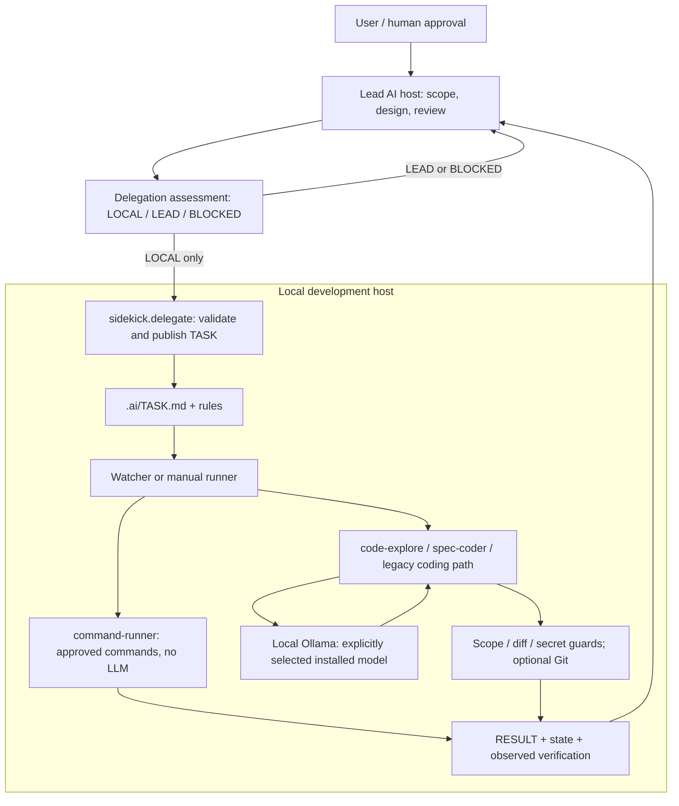

# Local AI Sidekick

[English](README.md) | [日本語](README.ja.md)

**範囲を絞った開発タスクをローカルのWorkerに任せ、結果をレビューしてから変更を取り込みます。** Local AI Sidekickは、ファイルでタスクを受け渡すPythonツールです。承認済みコマンドはモデルなしで、コードの読み取り調査や仕様を限定した編集はローカルのOllamaで実行できます。クラウドAIは引き続きLeadとして使えます。

[](https://github.com/moruku36/local-ai-sidekick/actions/workflows/ci.yml)

## ひと目で分かる現状

| 項目 | できること・確認できること |
| --- | --- |
| ファイルでの委譲 | Leadが `.ai/TASK.md` に作業範囲を書き、Workerがレビュー用の `.ai/RESULT.md` を返す |
| Workerの実行モード | モデルなしで承認済みコマンドを実行するか、ローカルOllamaでコード調査や範囲を絞った編集を行う |
| お試し | Python 3.10以上。下の例はGPU・モデル・パッケージのインストール不要 |
| デスクトップ実験 | [11月6日の構成](docs/architecture-2026-11-06.md)は過去の記録。[その後の構成](docs/architecture-2026-11-18.md)には、Sidekickとは別に2026年11月19日に行ったStrataの実測を記録 |

## まず試す（GPU・モデル不要）

Python 3.10+があれば、このcheckoutで確認できます。

```powershell
$env:PYTHONPATH = 'src'
python -m sidekick.cli --help
python -m sidekick.security_audit --input tests/fixtures/security_audit/synthetic-auth.txt --source sshd --bsd-year 2026 --synthetic-or-public
```

モデル取得・パッケージインストールは不要です。監査例は合成fixtureのみを使い、修復操作は行いません。Bashでは各Pythonコマンドの先頭に `PYTHONPATH=src` を付けます。PowerShellの書き方と任意のモデル連携は[導入ガイド](docs/usage.md) / [詳細ガイド](docs/usage.ja.md)にあります。

## 仕組み

```text
ユーザー + Lead AI -> 範囲を決めたタスク -> ローカルWorker -> 結果と差分 -> Lead / 人のレビュー
```

要件・設計・安全判断・最終レビューはLeadが持ちます。Workerにはファイル・コマンドの制約がありますが、ホスト上のコマンド実行は完全なsandboxではありません。設定の既定値は `auto_git=false` / `auto_push=false`。WatcherモードはGit自動化を有効にするため、起動前に設定を確認してください。pushは明示opt-in、自動mergeは未対応です。[安全上の境界](SECURITY.md)も参照してください。



| 要素 | このrepoにあるもの |
| --- | --- |
| Leadの入口 | `AGENTS.md`、`CLAUDE.md`、委譲ルール、任意のホスト設定・bootstrap |
| 委譲 | `LOCAL / LEAD / BLOCKED` の判断と、`sidekick.delegate` による範囲を限定した `.ai/TASK.md` の発行 |
| CLIと実行 | `init` / `doctor` / `run` / `integrate` と `--watch` モード。手動実行、または別途起動するWatcher |
| モデル不要のロール | `command-runner`。承認済みコマンドを実行し、LLMとGit自動化は呼ばない |
| モデルを使うロール | 読取専用の `code-explore`、仕様限定の `spec-coder`、従来のcoding経路。設定したローカルOllamaを使う |
| レビュー材料 | `.ai/RESULT.md`、state、観測した検証結果、任意のGit制御。自動mergeはしない |
| Claude Code用資材 | 8つのagent定義、3つのskill、imports・hook。8サービスの稼働を意味しない |
| セキュリティログ監査候補 | 合成・公開入力のオフラインルール処理と、任意のローカルOllama補助。修復操作は行わない |

詳細は[ロール契約](docs/worker-roles.md)と[現在の実装・検証範囲](docs/current-status.md)を参照してください。`QUEUED`はタスクファイルの発行であり、Workerの実行完了ではありません。委譲helperはWatcherを起動しません。図はリポジトリの実装経路であり、特定の実機で動作確認した構成ではありません。

## 現在のモデル状況

- **Sidekickの実装:** モデルを使うWorkerはローカルOllamaに接続します。実際に導入済みのモデルを `SIDEKICK_MODEL` または `--model` で指定してください。旧既定値の `qwen2.5:14b` はコード上の設定で、現在の利用モデルを示すものではありません。
- **Strataでの別枠の実測:** [構成資料](docs/architecture-2026-11-18.md#model-operation--モデル運用)には、Strataを導入し、2026年11月19日にQwen3.8-Flash-NextのIQ3_SとUD-Q4_K_XLを実測した記録があります。DeepSeek V4.1-Flashはこの構成には導入していません。この結果はSidekickとStrataの連携を検証したものではなく、このリポジトリにStrata専用のアダプタはありません。
- **以前のGemma実験（11月3日）:** E4Bは[GoogleのGemma 4概要](https://ai.google.dev/gemma/docs/core)と[Ollamaのタグ一覧](https://ollama.com/library/gemma4/tags)を参照。希望していた `Q5_K_M` の配布タグとGPUへの適合は未確認です。

## 読むところ

| 知りたいこと | 文書 |
| --- | --- |
| 現在の機能と確認できた範囲、連携の限界 | [現在の実装・検証範囲](docs/current-status.md) |
| RTX 3070 の用途比較と次に試すこと | [今後の展開案](docs/future-directions.md) |
| 必要な時だけ使うクラウドGPU、費用ガード、Kaggleの境界 | [Modal GPU実験場](docs/modal-gpu-experiments.md) |
| GPUを使わない確認、Workerの設定・運用 | [短い導入ガイド](docs/usage.md) / [詳細ガイド](docs/usage.ja.md) |
| オフラインのログ監査例で確認できること | [監査ガイド](docs/security-audit.md) |
| 構成スナップショット（2026-11-06 / 2026-11-18）、文書一覧とフォルダ構成 | [docs入口](docs/README.md) |

## 押さえておく境界

- **委譲:** [AGENTS.md](AGENTS.md) と [.ai/DELEGATION.md](.ai/DELEGATION.md) が `LOCAL / LEAD / BLOCKED` を定義します（[運用ガイド](docs/usage.ja.md#自動委譲)）。タスクをキューに入れることは、完了を意味しません。
- **グローバル連携（任意）:** Codex / Claude Code の設定コードと指示ファイルはあります。ホスト設定を変える前に[連携ガイド](docs/usage.ja.md#グローバル連携任意)と[連携の確認範囲](docs/current-status.md#cloud-ai-integration-boundaries)を確認してください。Gemini / ChatGPT 製品との接続は検討段階で、このファイル方式自体が動作するconnectorを意味しません。
- **別システム:** HomeLab / OpenClaw はこのrepoの外です。Windows Defenderの状態収集はHomeLab側の運用で、このrepoの合成ログ監査候補とは分けて扱います。

## なぜローカルか

当初はクラウドAIのトークン節約を重視していました。いまの使い方では、クラウド側に任せてどんどん作れる場面が増えたので、ローカルに任せる理由を考え直しています。短い分類・抽出、ローカル検索の補助、音声文字起こしなどを、より単純な方法と比較予定で、coding offload は用途候補の一つです。クラウドが常に安い・速いという主張ではありません。

## ライセンス

[MIT](LICENSE)。
