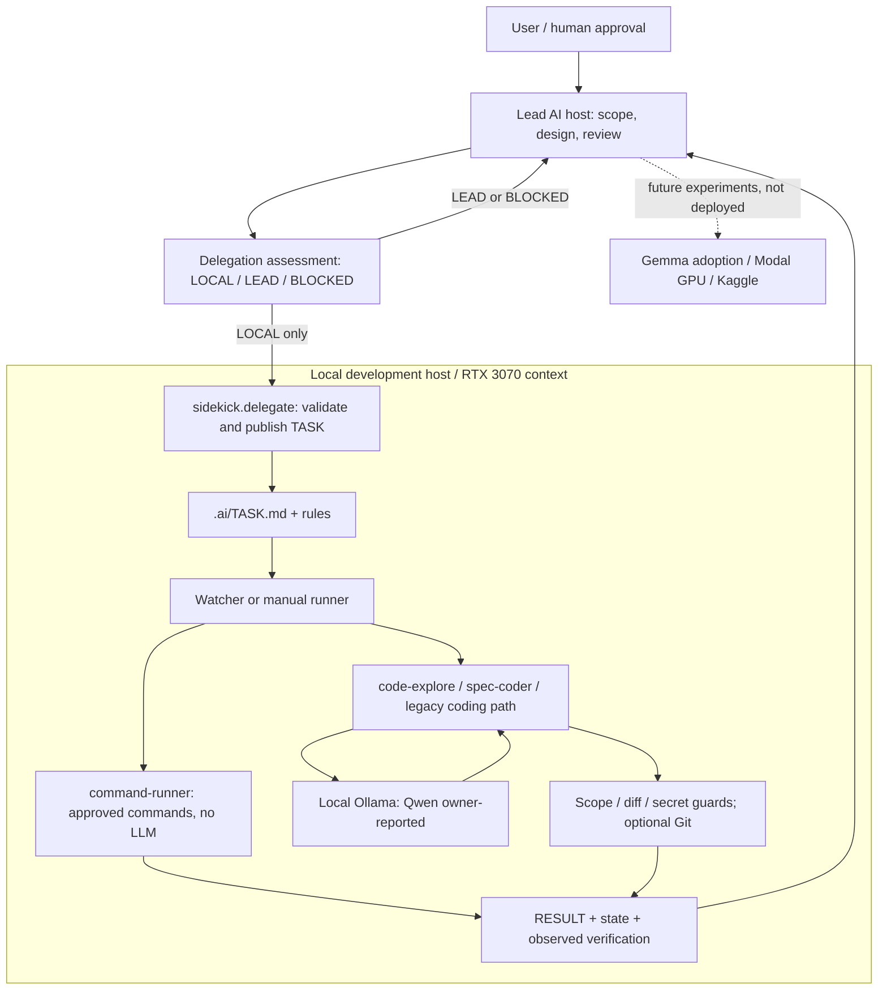

# Local AI Sidekick

[English](README.md) | [日本語](README.ja.md)

**強力なクラウドAIを主役に、手元の NVIDIA RTX 3070 を補助役として活かす方法を探すプロジェクトです。** Claude・Gemini・ChatGPT などと組み合わせながら、ローカルGPUに任せる意味のある仕事を試行錯誤しています。

- **いま試していること:** 本人の申告では、ローカルで Qwen を動かしています。モデルの詳細や、このリポジトリの各機能がGPUで実運用できたかは別の確認事項です。
- **このrepoにあるもの:** Ollama を使う coding Worker、範囲を決めた委譲、TASK / RESULT、Git制御、役割別の実行経路、合成ログを使うオフライン監査の候補実装。コード・合成テストの存在と実機運用の実績は区別します。
- **未実装・今後:** 短い分類・抽出、ローカル検索の補助、音声文字起こしなどを比較予定。各クラウド製品との接続も、実装や検証の有無を確認しながら探ります。coding offload は用途候補の一つです。

当初はクラウドAIのトークン節約を重視していました。いまの自分の使い方では、クラウド側に任せてどんどん作れる場面が増えたので、ローカルに任せる理由を考え直しています。クラウドが常に安い・速いという主張ではありません。

[](https://github.com/moruku36/local-ai-sidekick/actions/workflows/ci.yml)

## 現在の構成とアーキテクチャ — 2026-11-06

公開コードを基準にした整理で、実機の稼働確認ではありません。RTX 3070 / Qwen は本人の利用申告、Gemma導入とModal / Kaggleは計画です。Claude Code用のagent / skill定義は存在しますが、稼働サービスの証明ではありません。HomeLab / OpenClaw は別システムです。

[11月6日の構成一覧・アーキテクチャ図・ネットワーク図・根拠](docs/architecture-2026-11-06.md)を参照してください。



## モデル導入予定 — 2026-11-03

| 項目 | 予定・確認状況 |
| --- | --- |
| ローカルGPU | NVIDIA RTX 3070 |
| 採用予定モデル | Gemma 4 E4B |
| 希望する量子化 | `gemma4:e4b` + `Q5_K_M`（5-bit）。希望する構成の表記であり、実行可能な正式タグは未確認 |
| 導入状況 | 導入予定。今回の文書更新ではインストール・ダウンロード・ベンチマークは行わない |
| 今後の確認 | E4B Q5_K_Mの配布ファイル・正式なOllamaタグ、VRAMへの適合、推論速度、他の候補と比べた品質 |

ローカルAIサイドキックとして、この構成を使う予定です。現在の利用状況は上記のQwen動作の本人申告のままで、Gemmaの導入済み・実運用済みという意味ではありません。RTX 3070で最も推論性能がよいかは未確認です。

**2026-11-03確認の公式情報:** [GoogleのGemma 4概要](https://ai.google.dev/gemma/docs/core)でE4Bを、[Ollamaの公式タグ一覧](https://ollama.com/library/gemma4/tags)で`gemma4:e4b`を確認しました。同一覧ではE4Bの`Q5_K_M`正式タグを確認できていません。導入前に配布元・正確なファイルを選定します。モデル全体がVRAMに収まるか、実際の推論速度・品質は実機での確認が必要です。

## 読むところ

| 知りたいこと | 文書 |
| --- | --- |
| 現在の機能と確認できた範囲、連携の限界 | [現在の実装・検証範囲](docs/current-status.md) |
| RTX 3070 の用途比較と次に試すこと | [今後の展開案](docs/future-directions.md) |
| 必要な時だけ使うクラウドGPU、費用ガード、Kaggleの境界 | [Modal GPU実験場](docs/modal-gpu-experiments.md) |
| GPUを使わない確認、Workerの設定・運用 | [短い導入ガイド](docs/usage.md) / [詳細ガイド](docs/usage.ja.md) |
| 文書一覧とフォルダ構成 | [docs入口](docs/README.md) |

## 既存Workerの位置づけ

```text
ユーザー + Lead AI -> 範囲を決めたタスク -> ローカルWorker -> 結果と差分 -> Lead / 人のレビュー
```

要件・設計・安全判断・最終レビューはLeadが持ちます。Workerは許可ファイルとコマンドに制約がありますが、ホスト上のコマンド実行は完全なsandboxではありません。Git自動化は任意、pushは既定OFF、自動mergeは未対応です。[安全上の境界](SECURITY.md)も参照してください。

Windows Defenderの単純な状態収集にGPUは不要です。HomeLab側の運用と、このrepoの合成ログ監査候補は分けて扱います。

## ライセンス

[MIT](LICENSE)。
