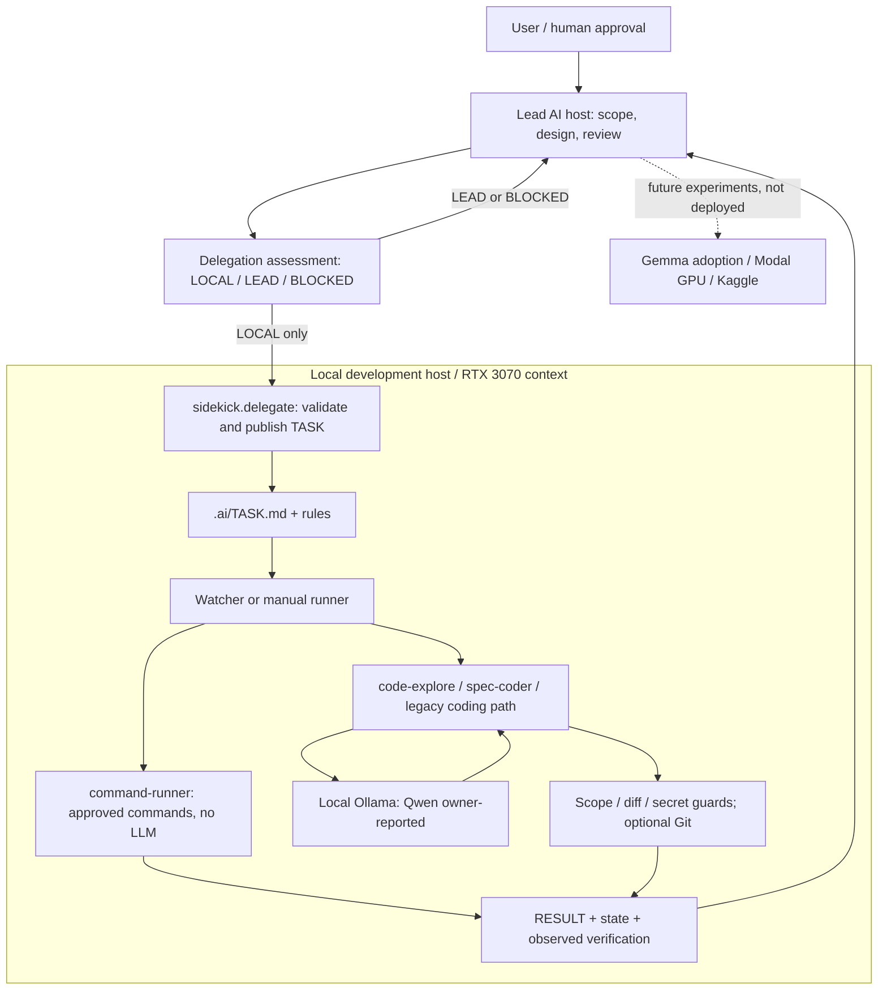

# Local AI Sidekick

[English](README.md) | [日本語](README.ja.md)

A place to explore useful supporting jobs for my local **NVIDIA RTX 3070**, with powerful cloud AI doing the main work. I am trying combinations with Claude, Gemini and ChatGPT; I am still deciding where the local GPU actually helps.

- **Trying now:** I have Qwen running locally, according to my own usage report. That does not establish which model configuration or Sidekick workflows have been validated on the GPU.
- **In this repository:** an Ollama coding Worker with bounded delegation, task/result files, Git controls, role-specific paths, and an offline synthetic security-log audit candidate. Code and synthetic tests are separate from real deployment evidence.
- **Next:** compare short classification/extraction, local search assistance and transcription against simpler alternatives. These are proposals, not implemented product integrations. Coding offload remains one experiment rather than the main strategy.

The motivation has shifted: in my current workflow, cloud AI often lets me keep building without worrying much about token use. This is a personal reason to reconsider local offload, not a claim that cloud AI is always cheaper or faster.

[](https://github.com/moruku36/local-ai-sidekick/actions/workflows/ci.yml)

## Current architecture — 2026-11-06

Source-backed snapshot, not a live deployment check: local RTX 3070/Qwen use is owner-reported; Gemma adoption and Modal/Kaggle experiments remain plans. Claude Code agent/skill definitions are present, not deployed services. HomeLab/OpenClaw are separate systems.

See the [dated architecture, network diagram and configuration evidence](docs/architecture-2026-11-06.md).



## Model adoption plan — 2026-11-03

| Item | Plan / status |
| --- | --- |
| Local GPU | NVIDIA RTX 3070 |
| Selected model | Gemma 4 E4B |
| Requested quantization | `gemma4:e4b` + `Q5_K_M` (5-bit); this is the requested configuration, not a confirmed runnable tag |
| Adoption status | Planned; this documentation update does not install, download or benchmark the model |
| Still to confirm | Exact E4B Q5_K_M distribution file / Ollama tag, VRAM fit, inference speed and quality compared with alternatives |

The owner plans to use this configuration as the local AI sidekick. The existing Qwen usage report remains the current reported state; this plan does not establish that Gemma is already in use or is the best-performing choice on the RTX 3070.

Sources checked on **2026-11-03**: [Google's Gemma 4 overview](https://ai.google.dev/gemma/docs/core) confirms E4B, and the [official Ollama tag list](https://ollama.com/library/gemma4/tags) lists `gemma4:e4b`. An official E4B `Q5_K_M` tag was not confirmed there. Select the exact distribution before installation; full GPU residency and performance remain unverified.

## Start here

| Looking for | Read |
| --- | --- |
| What exists, what is verified, and integration limits | [Current status](docs/current-status.md) |
| RTX 3070 options, sources and next experiments | [Future directions / 今後の展開案](docs/future-directions.md) |
| Episodic cloud GPU tests, cost guards and Kaggle boundaries | [Modal GPU experiments](docs/modal-gpu-experiments.md) |
| A GPU-free first look, then optional Worker setup | [Usage](docs/usage.md) / [詳細な日本語ガイド](docs/usage.ja.md) |
| All documents and the folder map | [Documentation index](docs/README.md) |

## How the existing Worker fits

```text
User + Lead AI -> bounded task -> local Worker -> result + diff -> Lead / human review
```

The Lead owns requirements, architecture, security decisions and final review. The Worker has file/command guards; local command execution still interacts with the host and is not a complete sandbox. Git automation is optional, push defaults to off, and automatic merge is unsupported. See [SECURITY.md](SECURITY.md).

Windows Defender state collection does not need a GPU. It belongs to the separate HomeLab operations workflow; Sidekick's synthetic-log audit is a different, unverified deployment candidate.

## Automatic Delegation

For existing instruction links: [AGENTS.md](AGENTS.md) and [.ai/DELEGATION.md](.ai/DELEGATION.md) define `LOCAL / LEAD / BLOCKED`. See the [operating guide](docs/usage.ja.md#自動委譲) for the helper, Watcher and review steps. Queueing a task does not mean it finished.

## Global Integration (Optional)

Codex / Claude Code setup code and instruction files exist. See the [optional setup guide](docs/usage.ja.md#グローバル連携任意) and [integration evidence limits](docs/current-status.md#cloud-ai-integration-boundaries) before changing host settings. Gemini / ChatGPT product connections are exploration ideas; the generic file protocol does not establish a working connector.

## License

[MIT](LICENSE).
