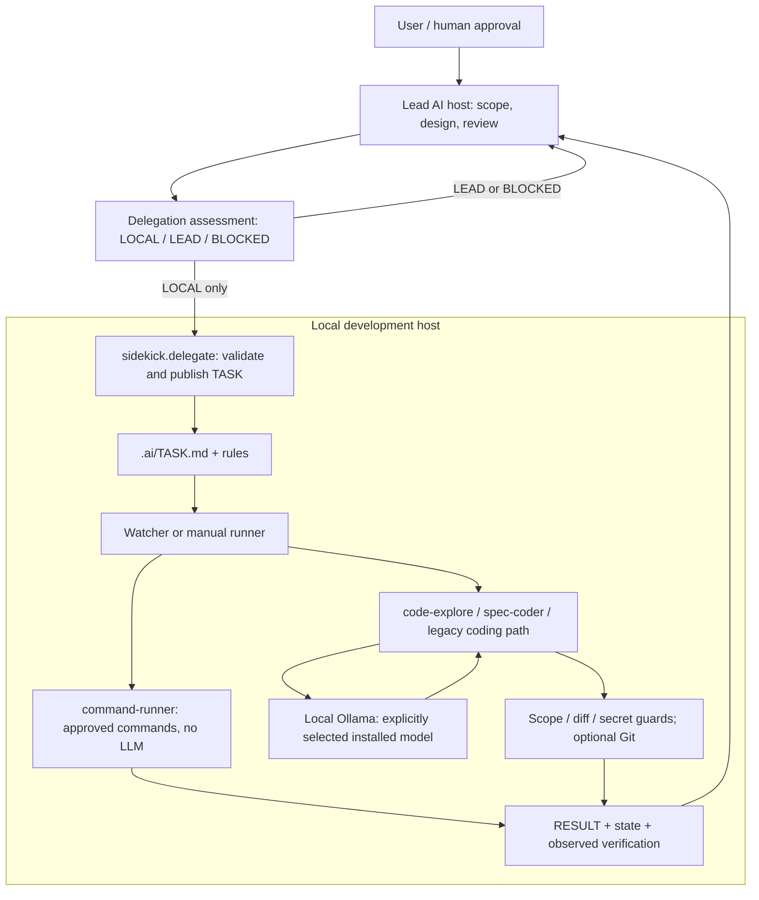

# Local AI Sidekick

[English](README.md) | [日本語](README.ja.md)

**Delegate a narrowly scoped development task to a local Worker, then review the result before accepting changes.** Local AI Sidekick is a Python toolkit that hands tasks off through files. It can run approved commands without a model, or use local Ollama for read-only code exploration and narrowly specified edits. Cloud AI can stay in the Lead role.

[](https://github.com/moruku36/local-ai-sidekick/actions/workflows/ci.yml)

## At a glance

| Item | What is available |
| --- | --- |
| File-based handoff | A Lead AI scopes the task in `.ai/TASK.md`; the Worker writes `.ai/RESULT.md` for review |
| Worker modes | Run approved commands without a model, or use local Ollama to explore code and make scoped edits |
| Quick start | Python 3.10+; the examples below need no GPU, model, or package installation |
| Desktop experiments | The [November 6 architecture snapshot](docs/architecture-2026-11-06.md) is historical. The [newer architecture report](docs/architecture-2026-11-18.md) records separate Strata measurements from November 19, 2026 |

## Try it (no GPU, no model)

With Python 3.10+, run from this checkout:

```bash
PYTHONPATH=src python -m sidekick.cli --help
PYTHONPATH=src python -m sidekick.security_audit --input tests/fixtures/security_audit/synthetic-auth.txt --source sshd --bsd-year 2026 --synthetic-or-public
```

No model or package installation is needed. The audit example uses a synthetic fixture only and applies no remediation. PowerShell syntax and the optional model-backed setup are in the [usage guide](docs/usage.md) / [detailed Japanese guide](docs/usage.ja.md).

## How it works

```text
User + Lead AI -> bounded task -> local Worker -> result + diff -> Lead / human review
```

The Lead owns requirements, architecture, security decisions and final review. The Worker runs with file/command guards, but host command execution is not a complete sandbox. Defaults are `auto_git=false` and `auto_push=false`; Watcher mode enables Git automation, so review its settings before starting it. Push is opt-in; automatic merge is not supported. See [SECURITY.md](SECURITY.md).



| Component | What exists in this repository |
| --- | --- |
| Lead entrypoints | `AGENTS.md`, `CLAUDE.md`, delegation policy, optional host setup/bootstrap |
| Delegation | `LOCAL / LEAD / BLOCKED` assessment; `sidekick.delegate` publishes bounded `.ai/TASK.md` requests |
| CLI and execution | `init`, `doctor`, `run`, `integrate`, plus `--watch` mode; manual run or a separately started Watcher |
| Model-free role | `command-runner` executes approved commands without an LLM or Git automation |
| Model-backed roles | Read-only `code-explore`, bounded `spec-coder`, and the legacy coding path, using the configured local Ollama |
| Review evidence | `.ai/RESULT.md`, state, observed verification, optional guarded Git changes; no automatic merge |
| Claude Code assets | 8 agent definitions and 3 skills, plus imports/hook — instruction files, not 8 deployed services |
| Security-log audit candidate | Offline rules over synthetic/public inputs, with optional local Ollama assistance; no remediation |

Details: [role contracts](docs/worker-roles.md) and [current status / integration limits](docs/current-status.md). `QUEUED` means a request file was written, not that a Worker ran. The delegation helper does not start the Watcher. The diagram shows the paths implemented in this repository, not a verified deployment on a particular machine.

## Model status

- **Implemented in Sidekick:** Model-backed Worker roles use local Ollama. Set `SIDEKICK_MODEL` or pass `--model` with an installed model. The legacy fallback `qwen2.5:14b` is a code default, not a statement of current use.
- **Strata, measured separately:** The [architecture report](docs/architecture-2026-11-18.md#model-operation--モデル運用) records a Strata installation and November 19, 2026 measurements for Qwen3.8-Flash-Next in IQ3_S and UD-Q4_K_XL. DeepSeek V4.1-Flash was not deployed on that setup. These results do not verify Sidekick integration with Strata, and this repository has no native Strata adapter.
- **Earlier Gemma experiment (November 3):** The [Google Gemma 4 overview](https://ai.google.dev/gemma/docs/core) and [Ollama tag list](https://ollama.com/library/gemma4/tags) were cited for E4B. The requested `Q5_K_M` tag and GPU fit were not verified.

## Documents

| Looking for | Read |
| --- | --- |
| What exists, what is verified, and integration limits | [Current status](docs/current-status.md) |
| RTX 3070 options, sources and next experiments | [Future directions / 今後の展開案](docs/future-directions.md) |
| Episodic cloud GPU tests, cost guards and Kaggle boundaries | [Modal GPU experiments](docs/modal-gpu-experiments.md) |
| A GPU-free first look, then optional Worker setup | [Usage](docs/usage.md) / [詳細な日本語ガイド](docs/usage.ja.md) |
| What the offline security-log example checks | [Audit guide](docs/security-audit.md) |
| Architecture snapshots (2026-11-06 / 2026-11-18), all documents and the folder map | [Documentation index](docs/README.md) |

## Boundaries worth knowing

### Automatic delegation

[AGENTS.md](AGENTS.md) and [.ai/DELEGATION.md](.ai/DELEGATION.md) define `LOCAL / LEAD / BLOCKED`; see the [operating guide](docs/usage.ja.md#自動委譲). Queueing a task does not mean it finished.

### Global integration (optional)

Codex / Claude Code setup code and instruction files exist; see the [setup guide](docs/usage.ja.md#グローバル連携任意) and [integration evidence limits](docs/current-status.md#cloud-ai-integration-boundaries) before changing host settings. Gemini / ChatGPT product connections are exploration ideas — the generic file protocol does not establish a working connector.

### Separate systems

HomeLab / OpenClaw are not part of this repository. Windows Defender state collection belongs to that workflow; Sidekick's synthetic-log audit is a different, unverified deployment candidate.

## Why local at all

The original motive was saving cloud AI tokens. In the current workflow, cloud AI often lets the owner keep building without watching token use, so the local role is being reconsidered: short classification/extraction, local search assistance and transcription are candidates to compare against simpler alternatives, and coding offload remains one experiment rather than the main strategy. This is a personal workflow observation, not a claim that cloud AI is always cheaper or faster.

## License

[MIT](LICENSE).
