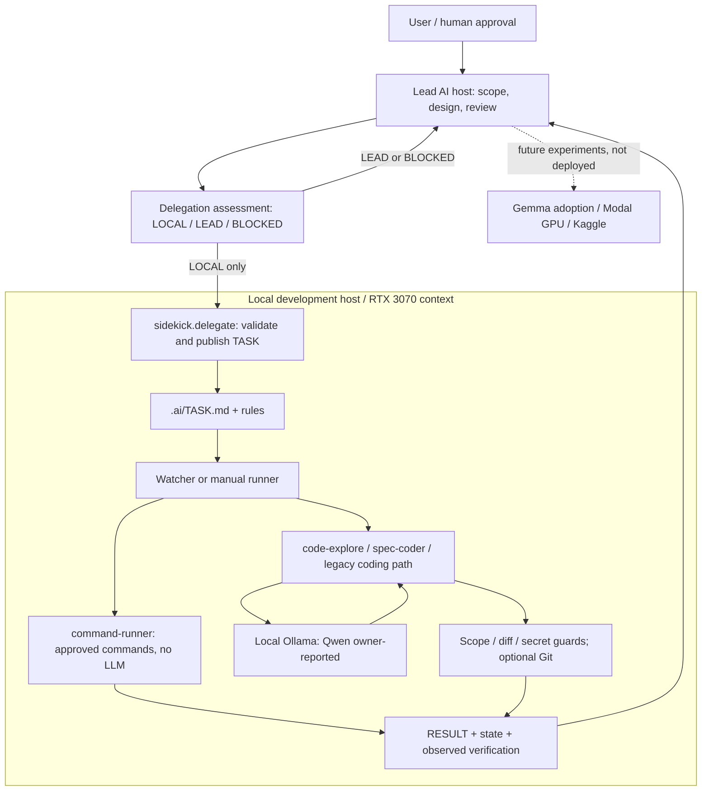
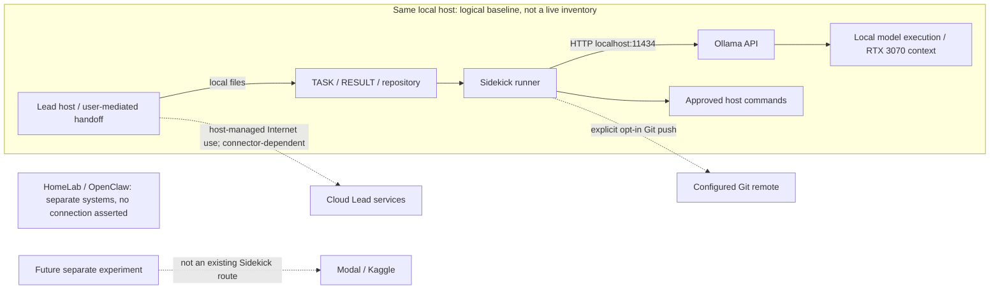

# Architecture snapshot / 構成スナップショット — 2026-11-06

[English overview](../README.md) | [日本語概要](../README.ja.md) | [Documentation index](README.md) | [Worker internals](architecture.md)

## Scope and evidence / 確認範囲

This is a source-backed snapshot of the current repository, based on main [`ad8f9bf`](https://github.com/moruku36/local-ai-sidekick/commit/ad8f9bf), including PRs #18–#21. It is **not a fresh live-host or GPU health check**. “Implemented” means present in source; owner-reported use, historical synthetic tests and future plans are distinct evidence levels. No model download, inference, deployment, credential change or paid experiment was performed for this documentation update.

main `ad8f9bf`（PR #18–#21を含む）の公開コード・文書を基準にした構成整理です。**11月6日に実機の稼働・GPU性能を測定した図ではありません。** 実装、本人の利用申告、過去の合成試験、今後の計画を区別します。この更新でモデル取得・推論・デプロイ・認証変更・有料実験は行いません。

## Architecture / アーキテクチャ図

Solid arrows describe implemented logical paths, not proof that every path is currently running. Dashed arrows to experiments are proposals. The Lead can be cloud-backed, but its product-specific connection is not implemented by this diagram. The Worker does not automatically delegate back to the Lead or start a new task from a result.

実線はコード上の経路で、常時稼働を示しません。実験への破線は計画です。Lead側の製品固有接続を実装済みとする図ではありません。RESULT更新からの自動再委譲はなく、WorkerがLeadへ再委譲する設計でもありません。

## Network and trust boundaries / ネットワークと信頼境界

| Path / 経路 | Current source contract / 現行コードの扱い |
| --- | --- |
| Lead → Worker | Local `.ai/TASK.md` and `.ai/RESULT.md`; no Sidekick inbound web service is required. ローカルファイルで受け渡し、Sidekick用の外向け待受APIは不要。 |
| Runner → Ollama | Default `http://localhost:11434`; health/models via `/api/tags`, generation via `/v1/chat/completions`. OpenAI-compatible syntax does not mean OpenAI/ChatGPT transmission. |
| Explicit model roles | `code-explore` / `spec-coder` validate a loopback HTTP endpoint and explicit port. The legacy client has a configurable URL; do not infer universal egress enforcement from the default. 明示ロールの制約を全経路の通信隔離と混同しない。 |
| Synthetic audit candidate | Offline rules by default; explicit `--ollama` uses fixed `127.0.0.1:11434`. No remediation actions. 合成監査は既定でオフライン、ローカルLLM補助は明示opt-in。 |
| Git remote | Optional publication of an approved branch; `auto_git=false`, `auto_push=false` by default. Transport follows the configured Git remote, not a fixed network port. 自動mergeなし。 |
| Cloud Lead services | Controlled by the selected host/client and user permissions, not an Ollama-to-cloud forwarding feature. No verified universal Gemini/ChatGPT connector is asserted. |
| Modal / Kaggle | Separate future experiments only. No adapter, deployment or live traffic is established here. No automatic overflow/fallback from the local Worker. |

No private IPs, machine names, account identifiers, tunnel endpoints or actual firewall rules are published. Loopback addresses above are generic defaults. This diagram does not authorize exposing Ollama to a LAN or the Internet. File/command guards are **not an OS sandbox or network firewall**; approved host commands can have side effects. Private data must not be sent to a cloud service merely because the local model cannot handle it.

プライベートIP・実ホスト名・アカウント識別子・トンネル接続先・実際のFW設定は公開しません。上記loopbackは一般的な既定値です。OllamaのLAN/Internet公開を認可する図ではありません。ファイル・コマンド制約は**OS sandboxや通信FWではなく**、ホスト実行には副作用があります。ローカルで処理できないデータを自動的にクラウドへ送る方針でもありません。

## Current components / 現在の構成

| Component / 要素 | State as of this snapshot / この整理での状態 | Evidence / 根拠 |
| --- | --- | --- |
| RTX 3070 + Qwen | Owner-reported local usage. Exact active tag, quantization, VRAM residency and performance are unmeasured here. 本人申告。実機再測定なし。 | [Current status](current-status.md), [model plan](../README.md) |
| Default model setting | Source default/example is `qwen2.5:14b`, not proof of the installed/running model. コードの既定値であり実機tagの確定ではない。 | [config.py](../src/sidekick/config.py), [example env](../config/sidekick.example.env) |
| Gemma 4 E4B / Q5_K_M | Adoption plan from Nov 3, not confirmed installed; exact distribution and GPU fit still open. 導入予定のまま。 | [README model plan](../README.md) |
| Python CLI + file protocol | init / doctor / run / watch / integrate, bounded delegation and result/state files exist. QUEUED does not mean executed. | [CLI](../src/sidekick/cli.py), [delegate](../src/sidekick/delegate.py), [runner](../src/sidekick/runner.py) |
| Worker roles | command-runner without model/Git automation; read-only code-explore; bounded spec-coder; legacy coding path. Detailed command output retention remains absent (`log_ref: null`). | [Role guide](worker-roles.md), [runtime gates](../src/sidekick/role_contract.py) |
| Lead integration assets | Codex instructions and Claude Code imports/hook plus **8 agent definitions and 3 skills** added in #18. These are instruction assets, not eight deployed services or proof of live execution. | [AGENTS.md](../AGENTS.md), [CLAUDE.md](../CLAUDE.md), [.claude/agents](../.claude/agents), [.claude/skills](../.claude/skills) |
| Synthetic security audit | Rule/evidence pipeline with optional local Ollama assistance; real-log deployment and live quality remain unverified. | [Audit guide](security-audit.md), [audit CLI](../src/sidekick/security_audit.py) |
| Modal / Kaggle | Documented experiment candidates, including Name That LLM and small-model evaluation/training. No existing runtime bridge or paid run proven by the merged docs. | [Experiment plan](modal-gpu-experiments.md) |
| HomeLab / OpenClaw | Separate systems. Their NUC, VM, scheduler, browser or gateway activity must not be counted as Sidekick deployments. このrepoの構成図に実接続として混ぜない。 | [System boundary](current-status.md#homelabとの境界) |

## Verification and next evidence / 検証の読み方と次の確認

The Oct 25 Windows/Python 3.11.9 record remains historical: 150 passed and 2 real-Ollama opt-in tests skipped. This snapshot does not relabel it as a Nov 6 GPU test. Repository CI validates code with synthetic/mocked tests; a green CI result is not a model-quality or deployment result.

10月25日のWindows/Python 3.11.9での150成功・実Ollama 2件skipは過去の記録として保持します。今回の日付に読み替えません。CI成功も実GPUやクラウド運用の証拠ではありません。

Before promoting a candidate to “operational,” record the actual model digest/tag and quantization, host/runtime versions, bounded input, selected role, observed result, VRAM/latency and failure/stop conditions. For cloud experiments also establish data permissions, a total cost limit and cleanup evidence under the existing [Modal safeguards](modal-gpu-experiments.md). This is an evidence checklist, not authorization to execute those experiments.

実運用済みにする前に、実際のモデル・量子化・runtime、入力範囲、ロール、観測結果、VRAM・遅延、中止条件を残します。クラウドはデータ持出し条件・総費用上限・停止確認も必要です。このチェックリスト自体は実験実行の許可ではありません。
