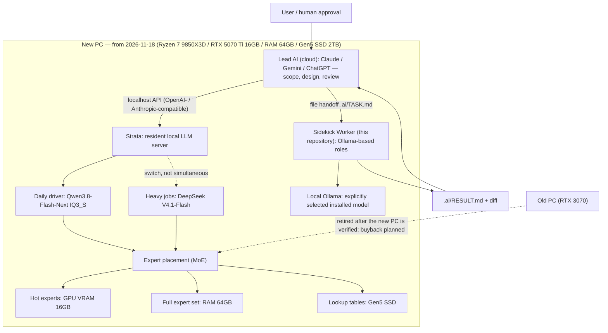

# Architecture / 構成 — from 2026-11-18 (new PC)

[English overview](../README.md) | [日本語概要](../README.ja.md) | [Documentation index](README.md) | [Previous snapshot: 2026-11-06](architecture-2026-11-06.md)

## Scope and status / 位置づけと状態

This document describes the local configuration that takes over **from Wednesday, 2026-11-18**, when the new PC is delivered. Until then, the [2026-11-06 snapshot](architecture-2026-11-06.md) (RTX 3070 host) describes the local setup.

この文書は、新PCが届く **2026-11-18（水）以降** のローカル構成をまとめたものです。それまでは [2026-11-06 のスナップショット](architecture-2026-11-06.md)（RTX 3070 のホスト）が現行構成です。

**Status: planned configuration, not measured results.** The hardware below is ordered and paid (Dospara Toyama-Hongo, total ¥655,640 tax included, paid 2026-11-11; delivery scheduled 2026-11-18, 18:00–20:00). Strata installation, model placement and every performance figure in this document are plans or vendor reference values until they are measured on the delivered machine and recorded here.

**状態は「計画構成」で、実測結果ではありません。** 下記ハードウェアは注文・支払い済みです（ドスパラ富山本郷店、税込 ¥655,640、2026-11-11 支払い完了、配送は 2026-11-18 18:00–20:00 予定）。Strata の導入、モデルの配置、性能の数値はすべて、到着後に実測してこの文書へ記録するまでは計画値・ベンダー参考値として扱います。

Sources: the PC order records summarized in the owner's PC purchase notes, and the Strata plan memo in [moruku36/Windows-Desktop-PC-Replace](https://github.com/moruku36/Windows-Desktop-PC-Replace) (`docs/strata-plan-20261111.md`, private repository).

根拠は、PC購入スペースにまとめた注文記録と、[moruku36/Windows-Desktop-PC-Replace](https://github.com/moruku36/Windows-Desktop-PC-Replace) の Strata 計画メモ（`docs/strata-plan-20261111.md`、非公開repo）です。

## Hardware / ハードウェア

| Component / 要素 | Specification / 仕様 |
| --- | --- |
| CPU | AMD Ryzen 7 9850X3D |
| Motherboard / マザーボード | ASUS TUF GAMING B850-PLUS WIFI |
| Memory / メモリ | CORSAIR DDR5-5600 64GB (32GB × 2, CMK64GX5M2D5600Z40) |
| GPU | PNY GeForce RTX 5070 Ti 16GB |
| Storage / SSD | ADATA XPG MARS 970 PLUS, M.2 Gen5, 2TB |
| PSU / 電源 | ASRock SL-1200P (1200W, 80+ Platinum) |
| Case / CPU cooler | Lian Li LANCOOL 217 / TRYX TURRIS T620 |
| OS | Windows 11 Pro |
| Peripherals / 周辺機器 | Logitech G502 HERO mouse, FIFINE AmpliGame AM8 microphone |

The old PC (Ryzen 7 5800X / RTX 3070 8GB / 32GB) stays in place until the new PC is verified working, and is then sold through a buyback service; it is not part of this configuration.

旧PC（Ryzen 7 5800X / RTX 3070 8GB / 32GB）は、新PCの動作確認が取れるまで残し、その後買取に出します。この構成には含めません。

## Architecture / アーキテクチャ図

Reading the diagram / 図の読み方:

- **Strata is the new local LLM platform.** It is a model-specific inference engine for the Qwen3.8-Flash-Next MoE (125B total parameters, ~6B active per token, 24,576 experts of which 10 activate per token). Frequently used experts sit in GPU VRAM, the full expert set in RAM, and lookup tables on SSD. It serves OpenAI-compatible and Anthropic-compatible APIs on localhost, so coding agents can connect to it.
- **Strata は新しいローカルLLM基盤です。** Qwen3.8-Flash-Next（125B の MoE、トークンごとに約6Bが活性化、エキスパート24,576個のうち10個を使用）に特化した推論エンジンで、使用頻度の高いエキスパートを GPU、全体を RAM、参照テーブルを SSD に分散配置します。OpenAI互換・Anthropic互換 API を localhost で提供し、コーディングエージェントから接続できます。
- **Models run one at a time.** The operating policy (adopted 2026-11-12) is: Qwen3.8-Flash-Next IQ3_S for daily use, DeepSeek V4.1-Flash for heavy jobs, never both at once.
- **モデルは片方ずつ運用します。** 2026-11-12 に採用した運用方針で、普段使いは Qwen3.8-Flash-Next IQ3_S、重い処理は DeepSeek V4.1-Flash、同時には動かしません。
- **The Sidekick Worker in this repository is unchanged.** Its implemented path still talks to Ollama (see the [2026-11-06 snapshot](architecture-2026-11-06.md)). A native Sidekick↔Strata adapter does not exist in this repository, and the explicit model roles still validate a loopback Ollama endpoint; treat any connection through Strata's compatible API surface as unverified until it is exercised and recorded.
- **このrepoの Sidekick Worker 自体は従来どおりです。** 実装済みの経路は Ollama を使います（[2026-11-06 のスナップショット](architecture-2026-11-06.md)）。Sidekick と Strata をつなぐ専用アダプタはこのrepoにはなく、明示ロールの検証対象も loopback の Ollama エンドポイントのままです。Strata の互換 API 経由の接続は、実際に試して記録するまで未検証として扱います。
- **Loading is heavy, so Strata is a resident server.** Startup reads roughly 35–55GB (cold start takes minutes), and requests are served one at a time by default. It is not a per-request launch tool.
- **読み込みが重いため、Strata は常駐サーバー前提です。** 起動時に約35〜55GBを読み込み、コールドスタートには数分かかります。既定では同時リクエストは1つずつ処理します。

## Model operation / モデル運用

| Role / 役割 | Model / モデル | Notes / 備考 |
| --- | --- | --- |
| Daily driver / 普段使い | Qwen3.8-Flash-Next IQ3_S (on Strata) | Reference figure ~53 tok/s on an RTX 5070 (12GB), from the engine's official materials. Not measured on this machine |
| Heavy jobs / 重い処理 | DeepSeek V4.1-Flash (on Strata) | ~4–6 tok/s reported on 12GB-class hardware. Whether it is practical at that speed is decided by measurement after delivery |
| Candidate / 候補 | Huihui-Qwen3.8-Flash-Next-abliterated-v2-GGUF | GGUF build recorded as a candidate on 2026-11-13. Abliterated (safety filters reduced) — handle with care. Adoption undecided; Strata / llama.cpp are the expected runtimes |

Quantization references for Qwen3.8-Flash-Next on Strata (vendor figures, RTX 5070 12GB): Q2_0 ≈ 94 tok/s (66GB download, ~40GB RAM), IQ2_XS ≈ 79 tok/s (68GB, ~42GB RAM), IQ3_XXS ≈ 62 tok/s (76GB, ~49GB RAM). With 64GB RAM, the full expert set fits in memory; the RTX 5070 Ti's 16GB VRAM holds more hot experts than the 12GB reference machine, so equal or better speed is expected — as an expectation, not a result.

Vendor benchmark context (Qwen's self-measured figures for the full-precision model): SWE-bench Pro 62.5, GPQA Diamond 91.7, LiveCodeBench v6 91.9. These are not same-condition comparisons, and a ~3-bit quantization should be discounted from the published full-precision numbers.

## Changes from the 2026-11-06 snapshot / 11月6日版からの変更

| Area / 項目 | Until 2026-11-17 | From 2026-11-18 |
| --- | --- | --- |
| GPU | RTX 3070 (8GB) | RTX 5070 Ti (16GB) |
| Memory / メモリ | 32GB | 64GB (DDR5-5600, 32GB × 2) |
| Local LLM platform / 基盤 | Ollama with a single selected model | Strata added for the large MoE models; Ollama path for the Sidekick Worker remains |
| Local model status / モデル | Qwen retired; successor undecided | Qwen3.8-Flash-Next IQ3_S (daily) / DeepSeek V4.1-Flash (heavy), one at a time — plan until measured |
| Old PC / 旧PC | Main host | Retired after verification; buyback planned |

## Verification after delivery / 到着後の確認

Before any item above is described as operational, record on the delivered machine:

実機で「運用中」と書けるようにするには、到着後に次を記録します。

1. Strata installation and version / Strata の導入とバージョン
2. Qwen3.8-Flash-Next IQ3_S: measured tok/s, VRAM and RAM usage, cold-start time / 実測 tok/s、VRAM・RAM 使用量、コールドスタート時間
3. DeepSeek V4.1-Flash: measured tok/s and a practicality judgement / 実測 tok/s と実用可否の判断
4. Whether the Huihui abliterated GGUF candidate is adopted / Huihui abliterated GGUF 候補を採用するか
5. Update this document with the measured values and dates / この文書へ実測値と日付を反映

## Boundaries / 境界

- Strata's APIs are localhost services. This document does not authorize exposing them to a LAN or the Internet.
- Strata の API は localhost のサービスです。LAN やインターネットへの公開を認める文書ではありません。
- HomeLab / OpenClaw remain separate systems, as in the previous snapshot.
- HomeLab / OpenClaw は、従来どおり別システムです。
- No private IPs, machine names or account identifiers are published here.
- プライベートIP、実ホスト名、アカウント識別子は公開しません。
